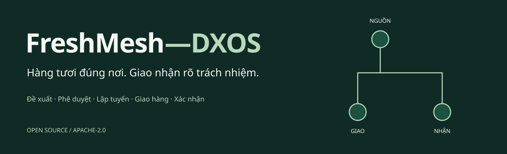

<!-- SPDX-License-Identifier: Apache-2.0 -->
<!-- Copyright 2026 FreshMesh-DXOS contributors -->


# FreshMesh-DXOS

[](https://github.com/EngLandLee/FreshMesh-DXOS/actions/workflows/unit.yml)
[](https://github.com/EngLandLee/FreshMesh-DXOS/actions/workflows/license.yml)
[](https://github.com/EngLandLee/FreshMesh-DXOS/actions/workflows/docker-e2e.yml)

**Nền tảng lõi mở cho điều chuyển hàng tươi, phê duyệt, lập tuyến và giao nhận có trách nhiệm.**

[Trang giới thiệu](https://englandlee.github.io/FreshMesh-DXOS/) · [Bản phát hành](https://github.com/EngLandLee/FreshMesh-DXOS/releases/latest) · [Hướng dẫn chạy](docs/GETTING-STARTED.md) · [Demo từng vai trò](docs/DEMO.md) · [Toàn bộ ảnh thực](docs/SCREENSHOTS.md)

## Mục lục

- [Bài toán và góc nhìn](#bài-toán-và-góc-nhìn)
- [Chức năng](#chức-năng)
- [Kiến trúc DX-OS](#kiến-trúc-dx-os)
- [Giao diện và luồng thực](#giao-diện-và-luồng-thực)
- [Chạy từ mã nguồn](#chạy-từ-mã-nguồn)
- [Cấu trúc repository](#cấu-trúc-repository)
- [Workflow Git và phát hành](#workflow-git-và-phát-hành)
- [Mã tự viết, sản phẩm tích hợp và giấy phép](#mã-tự-viết-sản-phẩm-tích-hợp-và-giấy-phép)
- [Tài liệu và cộng đồng](#tài-liệu-và-cộng-đồng)
- [Giới hạn công khai](#giới-hạn-công-khai)

## Bài toán và góc nhìn

Chuỗi mini-mart nhỏ thường có cửa hàng dư hàng tươi trong khi cửa hàng khác thiếu.
Một quyết định chuyển hàng kéo theo nhiều việc: chọn lô còn hạn, giữ tồn, xin duyệt,
gán tài xế, lập tuyến, xác nhận thực giao/thực nhận và lưu chứng từ. Dữ liệu rời rạc
khiến việc giao thiếu và trách nhiệm giữa các bên khó truy vết.

FreshMesh đặt **quy trình có trách nhiệm** làm trung tâm. Tồn kho không thay đổi theo
một nút bấm tùy ý: mỗi hành động phải đúng vai trò, đúng trạng thái Flowable và đúng
chuỗi/cửa hàng. AI chỉ hỗ trợ đọc hiểu; không thay người phê duyệt hoặc tự xuất hàng.

Dự án phục vụ mô hình DX-OS Open-Core của OLP 2026, chọn **HPDI P — Process** làm
không gian chính. Không dùng IoT, GPS phần cứng hoặc dịch vụ AI đóng bắt buộc.

## Chức năng

| Năng lực | Hành vi thực hiện |
|---|---|
| Tồn kho và đề xuất | Lô, hạn dùng, tồn khả dụng; dự báo trung bình bảy ngày; giải thích giả định và provenance |
| Phiếu điều chuyển | Tạo và giữ chỗ; chủ chuỗi duyệt/từ chối; không tự duyệt; từ chối trả lại lượng giữ |
| Lộ trình | Gom phiếu được duyệt, chọn tài xế, OR-Tools sắp điểm dừng, công khai khoảng cách ước tính |
| Xuất và giao | Tồn nguồn giảm khi dispatch; tài xế được giao nhiệm vụ ghi số thực giao và lý do thiếu |
| Nhận hàng | Cửa hàng đích xác nhận số thực nhận; tồn đích tăng đúng lượng; thao tác lặp bị kiểm soát |
| Chứng từ và lịch sử | S3 qua API có xác thực, SHA-256, actor timeline, process/task ID |
| Phân quyền | Keycloak PKCE; kiểm tra JWT, tenant, store, role tại server; không dựa vào ẩn nút UI |
| AI tùy chọn | Ollama/Qwen trả lời thật từ dữ liệu được phép; thiếu inference báo lỗi, không dùng câu trả lời dựng sẵn |

## Kiến trúc DX-OS

| Tầng | Vai trò | Thành phần |
|---|---|---|
| T1 — Headless Open-Core | Bốn dịch vụ bắt buộc dùng qua API | Keycloak; APISIX; PostgreSQL + SeaweedFS S3; Flowable |
| T2 — HPDI P | Portal quy trình cho người thao tác | HTML/CSS/JavaScript, SSO, task, evidence, trạng thái lõi |
| T3 — Nghiệp vụ | Điều chuyển và giao hàng | FastAPI, quy tắc tồn kho, khuyến nghị, OR-Tools |

[Kiến trúc chi tiết](docs/ARCHITECTURE.md) mô tả ranh giới tin cậy, dữ liệu và giới hạn
transaction giữa database và workflow. Ba tầng logic không đồng nghĩa ba container.
Bảy vùng chức năng tham chiếu không phải bảy service bắt buộc và không được tuyên bố
là đã triển khai hết. Landing page là trang giới thiệu, không thay UI quản trị nghiệp vụ.

## Giao diện và luồng thực

Ảnh được chụp bằng **Playwright/Chromium trên các dịch vụ thật**, dùng dữ liệu demo
giả lập. Không phải mockup; không phải bằng chứng về dữ liệu hay hiệu quả doanh nghiệp.

### Tổng quan và đề xuất


### Phê duyệt và lập tuyến


### Giao, nhận và chứng từ


[Gallery đầy đủ](docs/SCREENSHOTS.md) gồm SSO, tạo phiếu, trạng thái submitted,
route form, xác nhận nhận, bốn lõi và mobile. Ảnh và notice Apache-2.0 được phát hành
riêng; không nhét browser binary, database hoặc trọng số AI vào source archive.

## Chạy từ mã nguồn

Cần Docker Engine + Compose v2, make. Để chạy verification: Python 3.12+, uv,
Node.js 22+ và POSIX shell. Windows dùng WSL2 với Docker Engine/Compose đã kết nối.

```sh
git clone https://github.com/EngLandLee/FreshMesh-DXOS.git
cd FreshMesh-DXOS
cp .env.example .env
make up
curl --fail http://localhost:3180/api/health
make verify
make demo-check
npm ci --ignore-scripts
npx playwright install chromium
make ui-check
```

- **Portal:** http://localhost:3180
- **Landing nội bộ:** http://localhost:3180/about/
- **Landing công khai:** https://englandlee.github.io/FreshMesh-DXOS/
- **Password demo:** `demo123`, chỉ dùng trong môi trường phát triển cô lập.
- **Vai trò:** `manager_a1` tạo; `owner_a` duyệt/lập tuyến; `driver_a` giao;
  `manager_a2` nhận. `owner_b` dùng để kiểm tra cô lập chuỗi.

`make up` build mã FastAPI, Java workflow adapter và portal từ source. Engine tích
hợp sử dụng image upstream có giấy phép mở, pin phiên bản; không tuyên bố đã tự
build toàn bộ hệ điều hành bên trong các image.

```sh
make logs             # log dịch vụ, không chia sẻ secret
make down             # dừng; giữ nguyên volumes
make screenshots      # Playwright thật + gallery và license trong dist/screenshots
make site             # build website độc lập vào dist/site
make ai-up            # overlay Ollama + model tùy chọn
make release          # source archive, SHA256SUMS, manifest SBOM
```

[Hướng dẫn đầy đủ](docs/GETTING-STARTED.md): kiểm tra prerequisites, health, tài khoản,
trình duyệt Linux, môi trường container phát triển, khôi phục lỗi và giới hạn dữ liệu demo.
`make demo-check`/`make ui-check` tạo dữ liệu thật và tiêu thụ tồn; không tự xóa database.

## Cấu trúc repository

```text
backend/              FastAPI, policy, stock, recommendations, routing
workflow/             Java headless Flowable adapter và BPMN
portal/               UI vận hành với PKCE
website/              Landing page, CSS và banner SVG gốc
deploy/               Cấu hình Keycloak, APISIX, storage
scripts/              Verification, HTTP/browser flow, website, release và SBOM
LICENSES/             Giấy phép và provenance dependency
.github/              CI, PR/release/Pages, issue forms, review ownership, Dependabot
.devcontainer/        Môi trường Linux phát triển tái tạo được
docs/                 Hướng dẫn chạy, demo, API, kiến trúc và workflow Git
```

## Workflow Git và phát hành

Từ issue, tạo branch `feat/...`, `fix/...` hoặc `docs/...`; mở PR vào `main`.
Unit/static, license/source, build stack và HTTP/Playwright E2E chạy trên PR.
Ảnh cùng metadata được lưu thành workflow artifact để người review nhìn được luồng.
Không auto-merge dependency PR và không giả lập người review.

Tag SemVer `vX.Y.Z` kích hoạt workflow release: chạy verification và stack thật,
chụp gallery, đóng gói source, checksum và SBOM; chỉ publish release sau các gate đạt.
Website Pages deploy từ đúng source và ảnh đã kiểm chứng. Chi tiết branch policy,
quyền của jobs, rollback, tạo tag và release ở [GIT-WORKFLOW.md](docs/GIT-WORKFLOW.md).

## Mã tự viết, sản phẩm tích hợp và giấy phép

Mã FreshMesh tự viết gồm portal, landing, policy nghiệp vụ, adapter, BPMN, cấu hình,
script và tài liệu, được phát hành **Apache-2.0**. Không phân phối mã parent/PACO chưa
rõ quyền cấp phép. PostgreSQL, Keycloak, APISIX, SeaweedFS, Flowable, nginx, OR-Tools
và dependency giữ giấy phép của chúng; xem [inventory](LICENSES/INVENTORY.md).
Wrapper/API tích hợp không biến engine upstream thành mã của đội.

Source release chỉ có source/config/docs/license; không chứa `.env` thực, credentials,
runtime volumes, thư viện vendor, browser binary hoặc trọng số model. SPDX/notice,
lockfiles và audit source là các gate thực thi, không chỉ nội dung README.

## Tài liệu và cộng đồng

- [Bắt đầu và xử lý lỗi](docs/GETTING-STARTED.md)
- [Luồng demo 15 phút](docs/DEMO.md) · [Ảnh thực từng bước](docs/SCREENSHOTS.md)
- [Kiến trúc](docs/ARCHITECTURE.md) · [API](docs/API.md)
- [Git/PR/CI/release](docs/GIT-WORKFLOW.md) · [Changelog](CHANGELOG.md)
- [Bằng chứng verification](docs/VERIFICATION.md) · [AI tùy chọn](docs/OPTIONAL-AI.md)
- [Đóng góp](CONTRIBUTING.md) · [Code of conduct](CODE_OF_CONDUCT.md)
- [Hỗ trợ](.github/SUPPORT.md) · [Issue tracker](https://github.com/EngLandLee/FreshMesh-DXOS/issues)
- [Báo bảo mật riêng tư](SECURITY.md) · [Review ownership](.github/CODEOWNERS)

Người đóng góp được ghi nhận qua [lịch sử commit](https://github.com/EngLandLee/FreshMesh-DXOS/graphs/contributors),
không dựng hồ sơ đội, người tài trợ, khách hàng hoặc lời chứng thực. Banner là thiết
kế gốc; screenshot có provenance và giấy phép riêng.

## Giới hạn công khai

Dữ liệu giả lập; route dùng haversine, không phải bản đồ đường bộ/ETA; dự báo trung
bình bảy ngày, không phải federated learning. Nhập hàng/giảm giá là khuyến nghị,
chưa thực thi với nhà cung cấp/POS. AI tùy chọn chưa benchmark độ chính xác.

Trang Pages là giới thiệu và hướng dẫn công khai; stack nghiệp vụ mặc định chỉ bind
loopback, dùng cấu hình phát triển. Không mô tả đó là triển khai production an toàn
hoặc hứa điểm thi. Copyright 2026 FreshMesh-DXOS contributors — [Apache-2.0](LICENSE).
